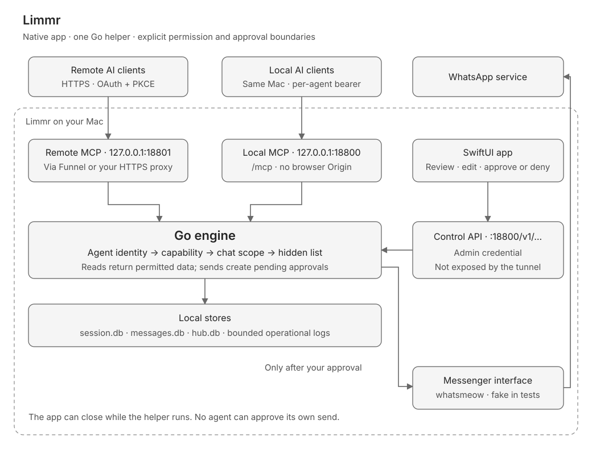

# Architecture

Limmr is a SwiftUI app with one Go helper. Swift gives the app native macOS controls, Liquid Glass and a Canvas people map. Go runs whatsmeow, the maintained WhatsApp multi-device implementation, and the MCP server. Everything ships in one app bundle; there is no separate Python or Node service.

## Processes and listeners

| Component | Address or location | Purpose |
| --- | --- | --- |
| SwiftUI app | `Limmr.app` | Setup, permissions, approvals, activity, people and health. |
| Go helper | `Contents/Helpers/limmr-engine` | WhatsApp connection, databases, policy and MCP. |
| Local MCP | `http://127.0.0.1:18800/mcp` | Per-agent bearer credentials. |
| Control API | `http://127.0.0.1:18800/v1/…` | App administration with the control credential. |
| Remote MCP | `http://127.0.0.1:18801/mcp` | OAuth 2.1, PKCE and approve-on-Mac sign-in, behind HTTPS. |

Both listeners bind to loopback. Local requests must use the exact host `127.0.0.1:18800` or `localhost:18800`; requests with an `Origin` header are rejected. The remote listener checks the configured public host. A tunnel exposes only the remote listener, never the control API.

The app registers the bundled helper using `SMAppService.agent(plistName:)`, with a plist under `Contents/Library/LaunchAgents/`. An ad-hoc build can fall back to `~/Library/LaunchAgents/dev.limmr.engine.plist` and `launchctl bootstrap`, when the user starts it. Quitting the app leaves the helper running. Settings provides **Stop engine**.

## Data on disk

The data directory is `$LIMMR_HOME`, defaulting to `~/Library/Application Support/Limmr`. Development uses a throwaway directory.

| File | Contents |
| --- | --- |
| `session.db` | WhatsApp device keys, mode 0600; never exported or logged. |
| `messages.db` | Chats, message text, media metadata and FTS5 search index. |
| `hub.db` | Agent profiles, credential hashes, permissions, approvals, activity, facts and relations. |
| `control-token` | App admin credential, mode 0600. |
| `status-token` | Read-only status credential, mode 0600. |
| `logs/engine.log` | Operational events without message text or credentials. |

Agent bearer and OAuth tokens are stored as SHA-256 digests, rather than reusable plaintext, in the hub. The app's control/status credential files are plaintext secrets protected by filesystem permissions. An AI client's own connection configuration may also retain its bearer token.

The operational log is capped at 20 MiB, retaining the last 5 MiB when trimmed. The activity database is separate: reads store message IDs, while approved sends and saved summaries retain text. Activity retention defaults to 180 days. This is not a promise that WhatsApp message history is deleted after 180 days.

## A read request

1. The client calls MCP with its bearer token, or an OAuth access token on the remote listener.
2. The engine resolves the agent from that credential. A client-supplied identity header is never authority.
3. The engine checks the capability, current chat scope and global hidden list. Tool discovery is filtered too.
4. The store returns only permitted records. Hidden or excluded chats do not appear in lists, search results or counts.
5. Activity records the agent, tool, time and message IDs. The app looks those IDs up when you inspect the activity.

## A send request

1. The engine checks send permission, recipient scope and the chat's send rule (from its circles; the strictest wins, no circle means confirm).
2. It builds the exact signed or unsigned payload as a draft with a 30-minute expiry. **Never** stops here with an error.
3. **Send freely**: with `send_now`, the engine delivers at once. **Confirm in chat**: the AI shows you the draft and calls `send_draft` with its id after you agree, no sooner than 2 seconds later.
4. Background runs, and handoffs outside quiet hours or their reply budget, park the draft on Home as a suggestion; you send, edit or dismiss it from the app.
5. The engine sends through its `Messenger` interface and records success or failure in Activity. The agent can ask `check_send` for the result.

Build tests use a fake `Messenger`. They never connect a live account or send messages, receipts, presence, typing indicators or group changes.

## People, remote access and migration

The people directory combines WhatsApp identities, groups and memberships with facts and relations. Agent edits are attributed, carry evidence IDs where available, and can be reverted. The app draws a bounded graph; the engine supplies nodes, edges and weights.

Remote clients use OAuth with PKCE and dynamic registration. A six-digit code must be approved on the Mac and assigned to an agent profile before access is granted. Tailscale Funnel or your own HTTPS proxy forwards to port 18801. The engine never configures Tailscale itself.

Migration is an explicit user action with a dry run and undo. It disables old jobs by renaming plists, copies the session/message stores, upgrades the schema and imports activity. Build verification uses invented stores only; the existing live installation remains untouched.

See [Security](SECURITY.md), [Connecting](CONNECTING.md) and the engine-owned [API reference](API.md).

## Tasks and owner-knowledge replication

Tasks are durable time-bound work in `hub.db`, with task events, checklist steps and workspace items. The detector proposes `status:suggested` tasks; suggestions stay outside the open list until confirmed. AIs and the owner can also create tasks directly. Single-chat project-circle migration archives its source and supports Undo. Derived efforts are local observations, not replicated tasks. Person-filtered task and effort queries apply the person constraint before their result limit and retain the caller's chat authorization.

Each engine has its own identity and hybrid clock. Transactional change-log hooks record allowlisted owner-knowledge writes. Replication merges objects by clock/origin and task items by item identity. It carries people, profile-photo references and normalized profile bytes, circles, tasks and other expressly allowlisted knowledge. It does not carry message history/media, WhatsApp sessions, AI profiles, OAuth credentials or general settings. A receiving engine projects replicated knowledge through its own local permissions. Hidden-chat choices are local settings: hiding a chat on one engine does not hide it on the other. Local person summaries and derived efforts are not in the current sync allowlist.

The dot initiates an outbound one-shot exchange against the peer's remote sync endpoints using a dedicated owner-granted sync permission. The CLI can be invoked by an external scheduler; pairing is not itself a background scheduling guarantee. Pause affects transport; Unpair retains owner knowledge. Control routes remain separate from remote sync authorization.

While paired, exactly one engine holds the automation lease (the Mac, from pairing). There is no takeover on silence, so a partition can leave zero holders but never two. The holder hands off by writing the new holder itself; it stops at once and the peer starts only after it syncs that write. Last-writer-wins on the lease is a total order, so both engines converge on the same holder without ever both believing they hold it. Unpairing makes each engine standalone. Slot/receipt reconciliation remains as a second line for engines older than this rule.

The test suite exercises policy boundaries with fake WhatsApp, including two-process OAuth and knowledge sync. The Linux workflow builds amd64 and arm64 engines and runs health/MCP smoke checks.
